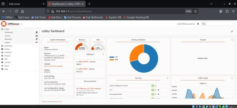
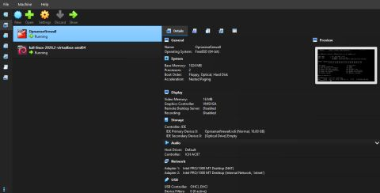

# Foundation: OPNsense + Kali on VirtualBox

The lab started with a virtual firewall/router and a pentesting workstation on an isolated network. Everything else in this repo builds on this.

## Setup

- **Hypervisor:** VirtualBox.
- **Firewall/router:** OPNsense (FreeBSD 64-bit VM). Adapter 1 is NAT (WAN); Adapter 2 is an Internal Network named `intnet` (LAN).
- **Workstation:** Kali Linux, attached to `intnet` and reaching the firewall GUI at `https://192.168.1.1`.
- **Network:** `192.168.1.0/24`, isolated from the host and other networks apart from the firewall's NAT.

## Screenshots

OPNsense dashboard, opened from Kali on the internal network:

VirtualBox Manager showing the firewall and Kali VMs running, with the NAT and Internal Network adapters:

## Problems solved early on

- DHCP leases not being handed out to clients
- Interface assignment and configuration on the firewall
- First-time web GUI access from the LAN side
