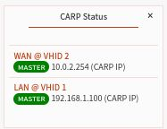
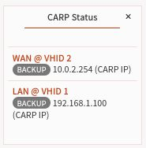

# OPNsense HA: CARP + pfsync

Two OPNsense VMs (Master and Backup) share a virtual IP so the LAN keeps its gateway if the Master dies.

## Setup

- Added a **third VirtualBox adapter** to both VMs for pfsync. VirtualBox blocks adapter changes on a saved VM, so discard the saved state first.
- pfsync interface: `em2`, `10.0.0.1/24` (Master) and `10.0.0.2/24` (Backup), gateway disabled. The interface must be both **assigned and enabled** before it shows under Firewall → Rules.
- CARP virtual IPs:

| VIP | Address | VHID |
|---|---|---|
| LAN | 192.168.1.100/24 | 1 |
| WAN | 10.0.2.254/24 | 2 |

- Advskew: Master `0`, Backup `100`.
- System → High Availability: sync via pfsync, XMLRPC config sync enabled.
- Backup LAN IP changed from a conflicting `192.168.1.1` to `192.168.1.2`.

## Findings

- Disconnecting virtual cables did **not** trigger failover (VirtualBox quirk). Powering off the Master did, with no ping loss.
- **Outbound NAT rules do not sync** via XMLRPC. Recreate them manually on the Backup.

## Screenshots

CARP Status widget on the firewall holding both virtual IPs (MASTER):

CARP Status widget on the standby firewall (BACKUP on both VIPs):

