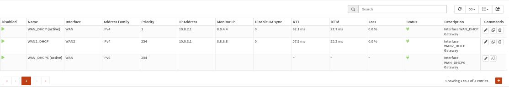

# Multi-WAN Failover Lab

A separate OPNsense VM cloned from the Master, used to practise gateway groups and failover.

## Adapters

| Adapter | Attached to |
|---|---|
| WAN1 | NAT Network `IPSIM1` |
| WAN2 | NAT Network `IPSIM2` |
| LAN | `intnet` (LAN IP 192.168.1.3) |

## Gateways

| Gateway | Priority | Monitor IP |
|---|---|---|
| WAN_DHCP | 1 | 8.8.4.4 |
| WAN2_DHCP | 254 | 8.8.8.8 |

## Issues

- The web GUI was accidentally switched to HTTP. Check which protocol is active if the page won't load.
- A duplicate-IP error came from typing the word "dynamic" literally into the IP field.
- Traceroute stars after hop 1 are a VirtualBox NAT Network ICMP limitation, not a fault.

## Screenshot

System → Gateways → Configuration, showing both WAN gateways with their priorities, monitor IPs, and live RTT with 0.0% loss:

