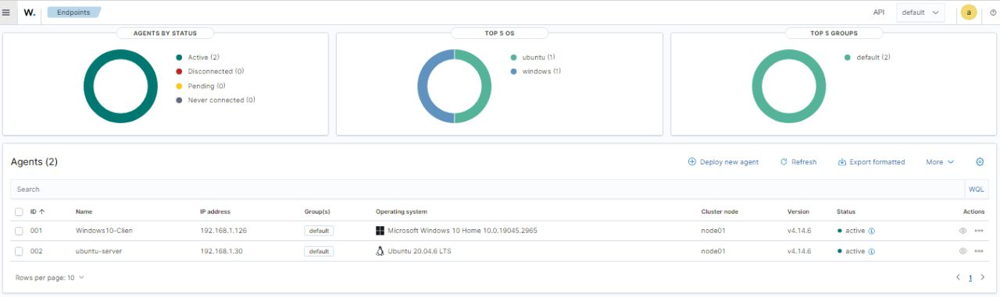

# Wazuh

## Manager

- Wazuh 4.14.6 OVA on `intnet` at `192.168.1.10`.
- The appliance has **no NetworkManager**. After most reboots the static IP is lost and the VM falls back to DHCP (`192.168.1.192`). Fix: `sudo service network restart`, then `ip a`.
- A typo (`IPADOR` instead of `IPADDR`) in `/etc/sysconfig/network-scripts/ifcfg-eth0` once broke the static IP.
- If the service crashes: `sudo systemctl restart wazuh-manager`.

## Agents

| Agent | Host | Address |
|---|---|---|
| 001 | Windows10-Client | 192.168.1.126 |
| 002 | ubuntu-server (20.04.6) | 192.168.1.30 |

### Windows 10 (32-bit, 2 GB RAM)

- Agent installed with the GUI installer, because PowerShell `Invoke-WebRequest` failed on TLS trust.
- Manager IP set manually in `ossec.conf` (edit Notepad as Administrator).
- The Windows service is named **Wazuh** and had to be started manually.

### Ubuntu Server (1 GB RAM, later 4 GB)

- Static IP `192.168.1.30/24`, OpenSSH enabled.
- Agent installed from the `.deb` with `dpkg -i`. A held `dpkg` frontend lock was caused by `unattended-upgrades`; stop that process, then run `sudo dpkg --configure -a`.
- If the agent will not start, open and re-save `/var/ossec/etc/ossec.conf` and check the `<address>` tag.

## Screenshot

Wazuh dashboard, Agents page, with both endpoints reporting as active:

