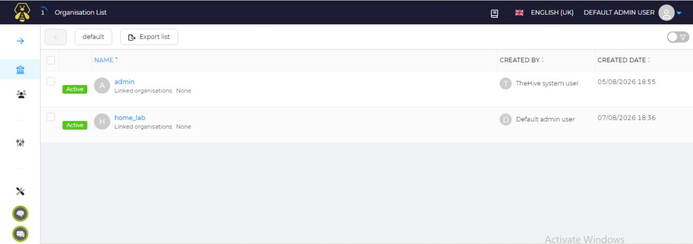
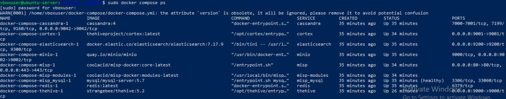
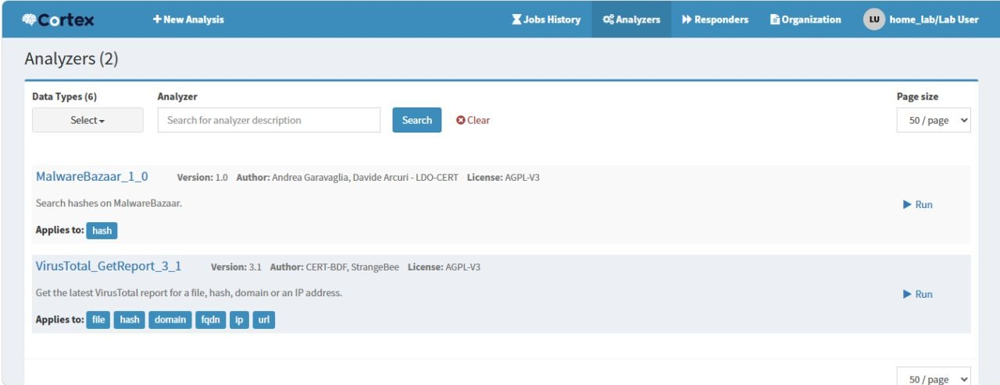

# TheHive + Cortex + MISP (Docker)

A Docker Compose stack running on the Ubuntu Server VM, adapted from a public sample compose file to fit this lab's network and a 4 GB RAM budget.

## Stack (9 containers)

TheHive (`strangebee/thehive:5.2`), Cassandra 4, Elasticsearch 7.17.9, MinIO, Cortex, MISP (`coolacid/misp-docker:core-latest`), MySQL 5.7, Redis, misp-modules. All on a `SOC_NET` bridge network.

| Service | URL |
|---|---|
| TheHive | `http://192.168.1.30:9000` |
| Cortex | `http://192.168.1.30:9001` |
| MISP | `https://192.168.1.30` (self-signed certificate) |
| MinIO | `http://192.168.1.30:9002` |

**Change every default credential and secret in your own copy.** Use placeholders in anything you publish.

## Install notes

- Docker installed from Docker's apt repo; use `docker compose` (plugin), with `sudo`.
- **Docker Hub rate limit** (`unauthorized: authentication required`): create a free account and run `docker login` (device-code flow).
- Interrupted pulls restart the partial layer; completed layers stay cached.
- **Disk full:** the root volume was 12 GB on a 25 GB virtual disk. Fixed with `lvextend -l +100%FREE` and `resize2fs`.
- **RAM:** 3 GB caused swap thrashing, Cassandra GC pauses and TheHive `WriteTimeoutException` errors. **4 GB is stable.** Cassandra gets `mem_limit: 1000m` with a reduced heap.
- **MISP hard-coded IP:** the sample compose pointed `HOSTNAME` and `MISP_BASEURL` at a hard-coded IP from a different network, causing an unstyled page and bad redirects. Set both to `https://192.168.1.30`.
- Services renamed `cortex.local` → `cortex` and `misp.local` → `misp`; TheHive's config is a bind mount at `./thehive/conf/application.conf`.

## Cortex

- Superadmin vs org-admin scoping matters: create the org and org-admin before enabling analyzers.
- Analyzers enabled: VirusTotal GetReport and MalwareBazaar.

## Organisations

TheHive has the default `admin` org and a working org `home_lab`. Alerts must be created by a user inside `home_lab`.

## Screenshots

TheHive Organisation List: the default `admin` organisation and the working `home_lab` organisation:

`docker compose ps` on the Ubuntu Server, showing all nine containers up:

Cortex Analyzers page for the `home_lab` organisation, with the MalwareBazaar and VirusTotal analyzers enabled:

