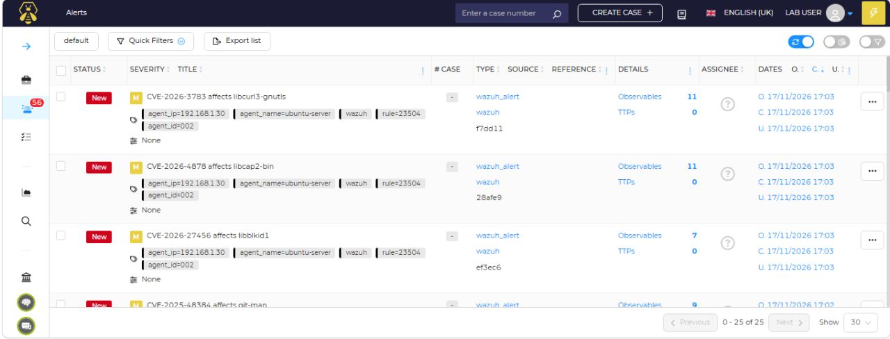
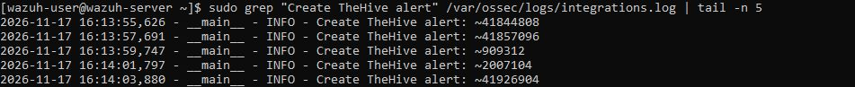

# Wazuh → TheHive Integration

Wazuh pushes alerts into TheHive using a custom integration script (originally published in `ls111-cybersec/wazuh-thehive-integration-ep13`, tested against TheHive 5.2.1). The script is the upstream author's work; the setup, fixes and tuning below are mine. Run everything on the **Wazuh manager**.

## 1. Install the TheHive module (pinned)

The script imports `thehive4py.api` and `thehive4py.models`, which exist only in 1.x.

```bash
sudo /var/ossec/framework/python/bin/python3 -m pip install thehive4py==1.8.1
```

> On this appliance `pip3`'s first line points at `/var/wazuh-manager/...`, which does not exist, so `pip3` fails with "No such file or directory". Running pip through the bundled Python (`python3 -m pip`) avoids it.

## 2. Download the scripts

```bash
sudo curl -o /var/ossec/integrations/custom-w2thive.py https://raw.githubusercontent.com/ls111-cybersec/wazuh-thehive-integration-ep13/main/custom-w2thive.py
sudo curl -o /var/ossec/integrations/custom-w2thive    https://raw.githubusercontent.com/ls111-cybersec/wazuh-thehive-integration-ep13/main/custom-w2thive
```

## 3. Permissions and threshold

```bash
sudo chmod 755 /var/ossec/integrations/custom-w2thive.py /var/ossec/integrations/custom-w2thive
sudo chown root:wazuh /var/ossec/integrations/custom-w2thive.py /var/ossec/integrations/custom-w2thive
sudo sed -i 's/^lvl_threshold=0/lvl_threshold=7/' /var/ossec/integrations/custom-w2thive.py
```

`lvl_threshold=0` forwards every alert and will flood TheHive.

## 4. Enable in `ossec.conf`

Add inside `<ossec_config>`, just after `</global>` (see [../config-examples/ossec-integration-block.xml](../config-examples/ossec-integration-block.xml)):

```xml
<integration>
  <name>custom-w2thive</name>
  <hook_url>http://192.168.1.30:9000</hook_url>
  <api_key>YOUR_THEHIVE_API_KEY</api_key>
  <alert_format>json</alert_format>
</integration>
```

Use `<name>`, not `<n>` (a rendering glitch in the original README). The API key must belong to a user **inside the `home_lab` org**.

```bash
sudo systemctl restart wazuh-manager
```

## 5. Verify

```bash
sudo grep "Create TheHive alert" /var/ossec/logs/integrations.log | tail -n 5
```

A `Create TheHive alert` line means success. `401/403` means a wrong key or org; a traceback tagged `EGOR` means a script error.

## Result

Alerts arrived in TheHive tagged with rule, agent name, agent ID and IP, with observables extracted. The first vulnerability-detector scan produced dozens of alerts (rules 23504/23505) within minutes, so noise tuning is the next task. Wazuh log timestamps are UTC; TheHive shows local time (UTC+1).

## Screenshots

TheHive Alerts page in the `home_lab` organisation, showing alerts created by Wazuh, each tagged with rule, agent name, agent ID and IP, plus extracted observables:



Wazuh manager `integrations.log`, confirming each alert created in TheHive (log times are UTC):


